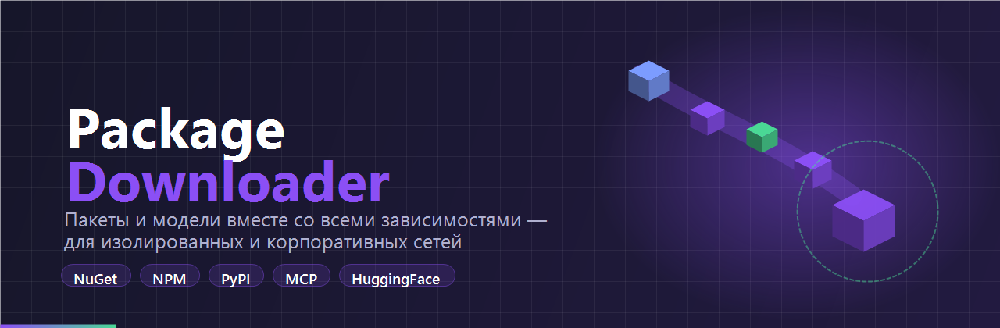

<div align="center">



<br>

[](#)
[](#)
[](../../releases/latest)
[](LICENSE)

**Скачивает пакеты NuGet, NPM, PyPI, MCP-серверы и модели HuggingFace вместе со всем деревом зависимостей — чтобы перенести их в сеть, где интернета нет.**

</div>

---

## Зачем это нужно

В изолированном контуре `nuget.org`, `registry.npmjs.org` и `pypi.org` недоступны. Скачать один пакет руками несложно — но за ним тянется два десятка зависимостей, у каждой свои диапазоны версий, у Python ещё и маркеры окружения.

Package Downloader решает это за один клик: вы выбираете пакет (или приносите свой `package.json`, `.csproj`, `requirements.txt`) — приложение само разворачивает всё дерево зависимостей, скачивает артефакты и раскладывает их в структуру, которую сразу умеют отдавать встроенные локальные реестры.

## Возможности

| Экосистема | Поиск | Дерево зависимостей | Массовая загрузка из файла |
|---|---|---|---|
| **NuGet** | по nuget.org | `.nuspec`, выбор версии по диапазону `[1.0,2.0)` | `.csproj`, `Directory.Packages.props`, `packages.config` |
| **NPM** | по registry.npmjs.org | semver-диапазоны `^ ~ x - \|\|`, dist-теги | `package.json` (dependencies / dev / peer / optional) |
| **PyPI** | по индексу PEP 503 | `requires_dist`, маркеры PEP 508, `requires_python` | `requirements.txt`, `pyproject.toml` (PEP 621 и Poetry), `Pipfile` |
| **MCP** | по registry.modelcontextprotocol.io | — | — |
| **HuggingFace** | модели и их файлы | — | — |

Дополнительно:

- **Локальные реестры** — встроенные NPM-реестр и NuGet-сервер (V3 API) на Node.js. Поднимаются из приложения в один клик, доступны всей сети: `npm config set registry http://сервер:4873/`.
- **Раздел «Локальные пакеты»** — что уже скачано, с фильтром по экосистеме и переходом в папку.
- **Жизнь в трее**, тёмная и светлая темы, запуск реестров из контекстного меню.

## Установка

1. Скачайте `PackageDownloader-x.y.z-x64.msi` со страницы [Releases](../../releases/latest).
2. Запустите — мастер поставит приложение в `Program Files`, создаст ярлыки и предложит запустить сразу.

Приложение собрано как **self-contained**: .NET на целевой машине устанавливать не нужно. Node.js нужен только если планируете поднимать локальные реестры.

> Обновление ставится поверх предыдущей версии. Перед установкой закройте приложение через значок в трее.

## Как пользоваться

### Загрузка пакета с зависимостями

Выберите раздел (NuGet / NPM / Python / MCP / LLM), найдите пакет, отметьте нужные версии и нажмите **Скачать**. В журнале будет видно всё дерево — отступ показывает уровень вложенности:

```
↓ flask 3.0.0
  ↓ Werkzeug 3.1.8
    ↓ markupsafe 3.0.3
  ↓ Jinja2 3.1.6
  ↓ click 8.4.2
    ↓ colorama 0.4.6
```

### Массовая загрузка по файлу проекта

Кнопка рядом с «Скачать» в каждом разделе: **package.json** (NPM), **Файл проекта** (NuGet), **requirements.txt** (Python). Содержимое можно вставить текстом или открыть файл с диска — приложение разберёт его и скачает все пакеты со всеми зависимостями.

### Локальные реестры

В разделе «Администрирование» укажите папки загрузки и порты, затем запустите нужный реестр. Клиенты настраиваются одной строкой:

```bash
# NPM
npm config set registry http://имя-сервера:4873/

# NuGet — в nuget.config
# <add key="Local" value="http://имя-сервера:5000/v3/index.json" />
```

Реестры ищут пакеты рекурсивно, на любой глубине вложенности папок, и перечитывают папку каждые 5 секунд — свежескачанное видно без перезапуска.

## Как разрешаются зависимости

<details>
<summary><b>NuGet</b></summary>

Зависимости читаются из `.nuspec` внутри `.nupkg`, группа выбирается по целевой платформе. Версия подбирается через `VersionRange.FindBestMatch`; если диапазон не указан — берётся последняя стабильная.
</details>

<details>
<summary><b>NPM</b></summary>

Полная поддержка semver-диапазонов: `^1.2.3`, `~1.2`, `1.2.x`, `>=1 <2`, `1.2.3 - 2.0.0`, `a || b`, dist-теги (`latest`, `next`). Пред-релизы берутся, только если диапазон их явно упоминает. Ссылки `file:`, `git:`, `workspace:` пропускаются с предупреждением.
</details>

<details>
<summary><b>PyPI</b></summary>

Основной источник — `requires_dist` из JSON API. Версия выбирается по спецификаторам PEP 440 (`>=1.2,<2.0`, `~=1.4.2`, `==1.4.*`) с учётом `requires_python`, а маркеры PEP 508 (`python_version`, `sys_platform`, `extra`) вычисляются для версии Python из настроек — при 3.8 и 3.12 дерево будет разным, ровно как у `pip`.

У старых пакетов PyPI не отдаёт `requires_dist` вовсе. Тогда зависимости читаются **прямо из скачанного архива**: `*.dist-info/METADATA` в wheel, `PKG-INFO` или `*.egg-info/requires.txt` в sdist. Так, например, у `docx 0.2.4` подтягиваются `lxml` и `Pillow`, которых в API просто нет.
</details>

## Куда всё складывается

Единая раскладка для всех экосистем — её же понимают локальные реестры:

```
<папка загрузки>/
  <имя пакета>/
    <версия>/
      <файлы пакета>
      metadata.json | metadata.nuspec
```

## Сборка из исходников

```bash
git clone https://github.com/GamoffVad/PackageDownloader.git
cd PackageDownloader
dotnet build -c Release
```

Установщик (нужен [WiX 5](https://wixtoolset.org/)):

```bash
dotnet tool install --global wix
wix extension add -g WixToolset.UI.wixext
pwsh -File Installer/build.ps1 -Version 1.0.0
```

Готовый `.msi` появится в `Installer/out/`.

## Стек

.NET 9 · WPF · NuGet.Protocol · Markdig · Node.js (локальные реестры) · WiX 5 (установщик)

## Лицензия

[MIT](LICENSE)
